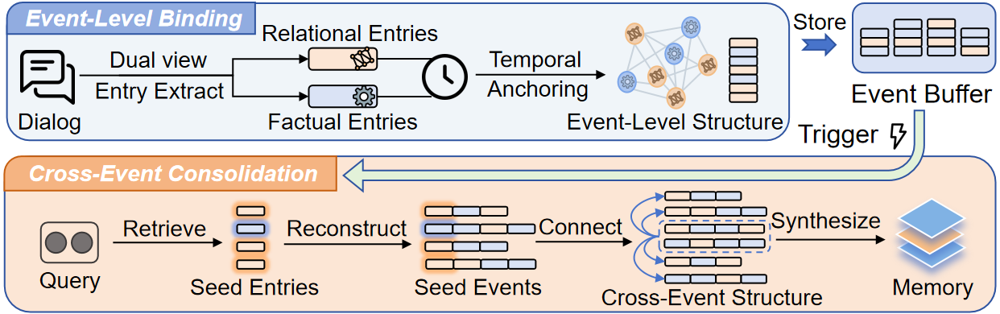

<div align="center">
  <h1>StructMem</h1>
  <p><b>Structured memory for long-horizon behavior in language and multimodal models.</b></p>
</div>

<p align="center">
  <a href="https://github.com/zjunlp/StructMem"></a>
  
  
</p>

<p align="center">
  <a href="#quick-start"><b>🚀 Quick Start</b></a> &nbsp;·&nbsp;
  <a href="#how-it-works"><b>🏗️ How It Works</b></a> &nbsp;·&nbsp;
  <a href="#repository-layout"><b>📦 Repository</b></a> &nbsp;·&nbsp;
  <a href="#citation"><b>📄 Citation</b></a>
</p>

<div align="center">
  
</div>

<details>
<summary><b>📑 Table of contents</b></summary>

- [📢 News](#news)
- [🎯 What is StructMem](#what-is-structmem)
- [🚀 Quick Start](#quick-start)
- [🏗️ How It Works](#how-it-works)
- [📦 Repository Layout](#repository-layout)
- [🧪 Tests and Evaluation](#tests-and-evaluation)
- [📄 Citation](#citation)
- [⚖️ License](#license)

</details>

---

<span id="news"></span>

## 📢 News

- **[2026-10-26]**: 🗂️ As the project grew beyond text-only memory, the implementation moved from [LightMem](https://github.com/zjunlp/LightMem) into this standalone [StructMem](https://github.com/zjunlp/StructMem) repository.
- **[2026-10-24]**: 🖼️ StructMem now supports **multimodal memory**.
- **[2026-04-24]**: 🎉🎉🎉 [**StructMem: Structured Memory for Long-Horizon Behavior in LLMs**](https://arxiv.org/abs/2604.21748) has been accepted by **ACL 2026**!

<span id="what-is-structmem"></span>

## 🎯 What is StructMem

StructMem builds memories around events instead of isolated flat facts.
Its text implementation combines event-level factual and relational extraction with temporal anchoring and cross-event summarization.
The multimodal implementation extends the same direction to ordered text and image evidence with persistent, user-isolated retrieval.

| Implementation | Best for | Entry point |
| --- | --- | --- |
| 📝 **Text** | Long-horizon conversation memory and LoCoMo experiments | [`text/`](text/README.md) |
| 🖼️ **Multimodal** | Text/image evidence storage and retrieval as a service | [`multimodal/`](multimodal/README.md) |

<span id="quick-start"></span>

## 🚀 Quick Start

### 📝 Text implementation

```bash
cd text
python -m venv .venv
source .venv/bin/activate
python -m pip install -e '.[dev]'
```

The canonical Python package namespace is `structmem`:

```python
from structmem.memory.structmem import StructMemory
```

Read the method guide in [`text/StructMem.md`](text/StructMem.md) and the LoCoMo workflow in [`text/experiments/locomo/readme.md`](text/experiments/locomo/readme.md).

### 🖼️ Multimodal service

```bash
cd multimodal
python -m venv .venv
source .venv/bin/activate
python -m pip install -e '.[dev]'
export MEMORY_API_KEY='change-me'
python -m uvicorn service.multimodal:app --host 127.0.0.1 --port 18084
```

The service exposes interactive API documentation at `http://127.0.0.1:18084/docs`.
Configure remote encoders or optional local models using the variables documented in [`multimodal/.env.example`](multimodal/.env.example) and [`multimodal/SERVICE.md`](multimodal/SERVICE.md).

<span id="how-it-works"></span>

## 🏗️ How It Works

### Text memory

1. **Event extraction** preserves factual components, relational components, and temporal bindings.
2. **Hierarchical consolidation** connects related events within a time window and stores cross-event summaries alongside detailed memories.
3. **Scoped retrieval** combines the resulting memories for long-horizon question answering.

### Multimodal memory

1. **Ingestion** stores original text and image evidence with ordered metadata.
2. **Encoding** supports remote multimodal embeddings, optional local CLIP, and lexical matching.
3. **Evidence retrieval** combines the available signals and returns source evidence with user isolation and persistent SQLite storage.

<span id="repository-layout"></span>

## 📦 Repository Layout

```text
StructMem/
├── text/                 # Original text-only StructMem implementation
│   ├── src/structmem/    # Canonical Python package namespace
│   ├── experiments/      # LoCoMo construction and evaluation scripts
│   └── StructMem.md      # Method guide and examples
├── multimodal/           # Standalone multimodal memory service
│   ├── service/           # FastAPI application and retrieval modules
│   ├── tests/             # Synthetic, credential-free tests
│   └── SERVICE.md         # API limits and configuration details
└── README.md
```

Datasets, credentials, model weights, runtime databases, generated memories, and benchmark outputs stay outside the repository.

<span id="tests-and-evaluation"></span>

## 🧪 Tests and Evaluation

Run the multimodal unit tests with synthetic content and mocked encoders:

```bash
cd multimodal
python -m pytest -q
```

The text project contains the LoCoMo construction and search scripts.
Their dataset paths, model endpoints, and output directories are supplied by the user; see [`text/experiments/locomo/readme.md`](text/experiments/locomo/readme.md).
Published or development scores should always include the exact dataset split, model, evaluator, and retrieval configuration.

<span id="citation"></span>

## 📄 Citation

Please cite the StructMem paper if you use the code or ideas in your work:

```bibtex
@misc{xu2026structmem,
  title={StructMem: Structured Memory for Long-Horizon Behavior in LLMs},
  year={2026},
  eprint={2604.21748},
  archivePrefix={arXiv},
  primaryClass={cs.CL},
  url={https://arxiv.org/abs/2604.21748}
}
```


<span id="license"></span>

## ⚖️ License

The implementations are released under the MIT License.
See [`text/LICENSE`](text/LICENSE) and [`multimodal/LICENSE`](multimodal/LICENSE).
